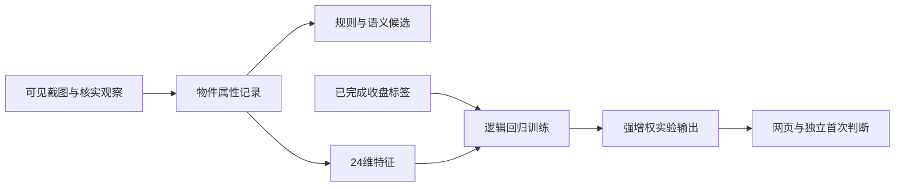

# 大霄译站

> 年少不懂李大霄，看懂已是中年人。
>
> 大霄老师是好人，只恨自己读不懂。

这一次，我用 AI 辅助完成视频捕捉与区域定位，从物品名称、颜色、摆放关系到谐音梗等多维线索进行识别，把“看不懂的背景”整理成**有截图、有证据、有解读链的结论**，再用发布后的真实行情检验这些猜想。

这就是「大霄译站」——把视频背景里的物件、颜色、摆放与谐音线索，翻译成可以核对的证据和解读。用 AI 读背景，用证据讲解读，用行情验猜想。开篇是项目发起者的个人感受，项目与视频作者无隶属或代言关系，寓意候选也不等于作者确认。

**[在线体验：大霄译站](https://xiaoxi.martin.wiki/)** · [部署说明](docs/deployment.md) · [隐私与公开范围](docs/privacy.md)

项目展示名已更新为「大霄译站」。仓库名与 npm 包名继续使用 `xiaoxi`，正式网站地址保持不变。

在线站点展示真实作品的观察与行情快照，由维护者的本机流程生成并同步到服务器；刷新可读取最近成功版本。站点含第三方视频截图，源码仓库不附带这些运行数据。模型估计仍为未校准实验结果。

当前为0.1研究原型：真实截图中的物件属性进入可解释分类器，网页默认只显示固定标准化L2=0.01的**强增权实验**，保留“实验／未校准”标识。该选择不表示它已优于基线；当前模型重看旧图不能算历史预测命中，也不能证明作者本意。代码以MIT发布。

## 真实视频与合成样例

项目支持李大霄真实视频的观察、截图、训练和行情验证。源码包没有附带本机已积累的真实档案；开源代码与运行数据分别保存。

`npm run demo`只用于检查空目录里的安装与页面功能，生成的是**合成样例**，不是实际案例展示，也不是预训练后的真实预测成绩。真实效果应查看已有真实档案生成的报告，或按照下方“真实数据流程”导入核实过的视频观察与截图。运行`demo`不会把已有真实档案替换成合成数据。

## 安装检查（合成样例）

需要Node.js 24.18或以上，可使用`.nvmrc`中的版本。演示核心可独立运行。

```sh
npm ci
npm run demo
npm run serve
```

打开终端给出的127.0.0.1地址，或打开`outputs/李大霄可视化报告.html`。演示包含64条合成记录、示意画面和虚构行情，全部标为合成；演示成绩没有真实预测意义。演示目录禁止混入真实观察、证据或行情，请在独立的干净目录处理真实数据。

## 实现范围

| 能力                                 | 当前状态                     |
| ------------------------------------ | ---------------------------- |
| 观察导入、证据SHA-256和裁切核验      | 已实现                       |
| 名称、颜色、位置、关系等24维编码     | 已实现，开放名称仍需补充编码 |
| 版本化语义、模型及不可变首次判断     | 已实现                       |
| 按日期分页、红涨绿跌、证据与相似案例 | 已实现                       |
| 日线与当日分钟行情、发布后窗口验证   | 已实现；缺历史分钟留空       |
| SSH/SFTP增量发布、HTTPS内容核验      | 已实现；需自行配置服务器     |
| 独立抖音查新、可见播放截图           | 需要外部采集适配器           |
| 图像识别服务                         | 需要人工核实或外部视觉适配器 |
| 邮件或其他自动通知发送               | 需要通知适配器；QQ邮件未实现 |

本开源核心消费已核实的结构化观察和截图清单。运行`report`本身不会登录抖音、自动识别新视频或发送通知；项目不下载原视频、不提供隐藏接口或规避访问限制的抓取器。

## 真实数据流程

在独立的干净目录运行：

```sh
npm ci
npm run init
npm run import -- path/to/observation.json
npm run evidence -- path/to/evidence-manifest.json
npm run report
npm run market
npm run report
```

先用`examples/`中的结构准备自己的真实输入，替换占位值。历史补录必须设`imported=true`和`baseline=true`。观察、证据、报告和行情更新须串行执行；目前不支持多个进程同时写同一档案。

`init`不会覆盖已有档案。重复作品ID、旧观察、证据和首次判断不覆盖；损坏档案会报错，不当作空库重建。`prices`可导入带真实抓取时间`updatedAt`的JSON，不能用导入时间冒充行情抓取时间。也可用`market`读取公开腾讯指数报价，接口没有服务保证。

完整研究比较需要足够的已完成目标日；目前约46个去重目标日才满足开发/后段分段的程序门槛，门槛不代表统计可靠性。数据不足或场景不适用时不强行输出概率。网页是生成时快照，更新数据后重新运行`report`。

## 架构与模型



监督训练发生在结构化特征到涨跌方向这一层，未训练新的图像识别网络。熊猫作中国资产语境候选，普通熊、纯绿植物等先验不强制成为统计权重。采访、共创、旅行、来源不明及缺可见道具的场景排除；港股等同类日常背景可以统一以上证作研究目标，作者原话市场另存。

按目标日去重，历史每折只使用发布时间之前已经15:05确认收盘的标签。开发段预先冻结四种配置比较，后段只评价开发选定配置；强增权展示为固定研究配置，不能挪用其他配置的成绩。原v4、旧v3和各版首次记录保留作独立档案。新标签重训当前视图，已锁定首次概率不改写。

交易日15:00前发布额外显示当天收盘与发布后对应分钟报价至收盘；15:00整及之后只用之后窗口。另列下一/3/5交易日和60/180交易分钟，午休剔除，缺数据留空。详见[模型说明](docs/model-versions.md)、[权重验证](docs/feature-weights.md)与[架构](docs/architecture.md)。

## 接入输出与通知

通知或其他应用应读取`outputs/可视化报告数据.json`中每条记录的`displayPrediction`：它是当前显示的强增权实验，含版本、涨跌估计、未校准标记及独立`firstEstimate`。`currentModelView`保留旧v4研究视图，不代表当前主卡。

采集与通知的输入契约、先锁定后验证流程见[适配器说明](docs/adapters.md)。凭据由适配器自己的环境变量或凭据管理器提供，不写入源码或运行档案。

## 本机生成，服务器展示

服务器只展示公开网页和登记JPEG；本机继续负责采集、视觉核实、模型与报告。支持增量传图、哈希校验、首页原子切换及无变化跳过。电脑离线时网站保留最后成功版本，不能因此称为服务器全自动分析。

```sh
npm run site:prepare
# 先按 docs/deployment.md 核实SSH身份、专用目录、域名和HTTPS，再显式发布
npm run site:publish -- --config work/deploy.json
npm run site:sync
```

同步默认关闭。个人连接配置留在被忽略的work目录；示例仅使用example.com，不含维护者服务器IP、用户名或密钥路径。不要上传整个本机工作目录，发布前同时检查Git暂存内容。[部署说明](docs/deployment.md)包含操作顺序与恢复边界。

## 开发与发布前检查

```sh
npm run check
npm run demo
```

`check`运行格式、测试与发布内容扫描。CI配置Windows和Ubuntu；首次推送后的远端运行结果以GitHub为准。`.gitignore`排除运行目录、截图、环境文件及常见凭据文件；扫描不能替代对实际提交内容的审查。

仅提交源码、文档及合成模板。请参阅[参与说明](CONTRIBUTING.md)、[数据问题反馈](SECURITY.md)、[更新记录](CHANGELOG.md)和[来源边界](NOTICE.md)。
