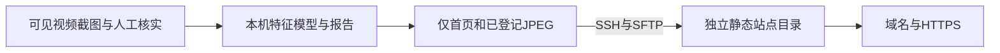

# 本机分析与静态网站部署

在线案例：[大霄译站](https://xiaoxi.martin.wiki/)。这是维护者运行的真实报告，仓库不携带该站点的登录态、截图、训练档案或连接配置。



本机需Node.js24.18及OpenSSH客户端；服务器需Python3和已配置的静态Web服务。发布程序不安装软件、不申请证书、不配置DNS，也不接管其他站点。阿里云Ubuntu22.04已用于实际验收，但通用模板不绑定该服务器。

## 准备自己的站点

先按已有服务器的实际情况建立大霄译站专用目录，例如/srv/xiaoxi。目录归部署账号可写，Nginx站点根目录为/srv/xiaoxi/site。已有非空目录且没有大霄译站标记时发布工具会拒绝使用；不要因此给原项目强行添加标记。

通过可信的服务器控制台核对SSH主机指纹，按正常SSH流程建立信任。连接参数启用StrictHostKeyChecking，不自动接受未知主机，也不要求把密码或私钥内容交给工具。生产使用专用部署账号，权限范围按自己的服务器设置。

将examples/deploy.example.json复制为work/deploy.json，填写自己的host、user、remoteBase、publicUrl；identityFile及knownHostsFile可指定本机文件路径，不填写密钥正文。将examples/site-sync.example.json复制为work/site-publish-config.json，先保留enabled=false。

确认目标服务器后，运行只读环境检查：

```sh
npm run site:check -- --config work/deploy.json
```

配置独立子域名和HTTPS。examples/nginx-https.conf使用保留示例域名；必须替换为自己的域名和证书路径，不能整段覆盖现有Nginx配置。证书签发、相应协议和自动续期由服务器管理者独立设置。

## 显式准备与发布

先生成真实报告。公开发布器拒绝合成安装样例，不把合成结果当真实站点。

```sh
npm run report
npm run site:prepare
npm run site:publish -- --config work/deploy.json
```

prepare只在work/site-releases生成版本化目录与清单，不联网。publish校验真实图片的登记SHA-256，仅发送index.html与缺少的JPEG。其他文件不在传输清单中。

服务器先校验所有文件，保留版本化首页和清单，再原子替换公开首页。相同文件名但内容损坏的图片会导致失败，不覆盖旧证据。发布暂存和历史版本位于站点根目录以外；本工具不自动开放这些目录。旧截图可能留在公开evidence目录，工具不是删除或撤回服务。

## 增量同步

手动发布及HTTPS验收后，把work/site-publish-config.json的enabled改为true。把同步命令接在自己的调度器或report成功之后：

```sh
npm run site:sync
```

同步包装器以报告SHA-256去重，无变化不连接服务器；有变化才发布，并从publicUrl正常验证HTTPS和页面哈希。不允许携带用户名、密码或查询凭据的URL，也不跟随其他地址的重定向。HTTP地址仅用于尚未启用HTTPS的调试，正式配置建议用HTTPS。

状态和锁位于work。同步失败保留原成功状态，下次重试；notice.pending表示首次失败或恢复尚待通知。通知适配器实际告知后运行npm run site:sync -- --ack-notice。工具本身不发送邮件，也不创建定时任务。

busy代表已有发布任务占用锁。进程中断后应核实没有对应进程，再处理残留锁，不并行强发。当前分析档案仍要求单写入进程。

如果激活完成后外网核验失败，服务器可能已切换新首页；状态只会记为未核验，不能保证网络故障发生在上传之前，也不自动回滚。历史首页保留供管理者核实后恢复。

电脑离线时服务器继续展示最后成功报告，新的采集与分析暂停。该流程不是服务器独立运行的视觉采集系统。公开图片及个人信息边界请先看[隐私说明](privacy.md)。
